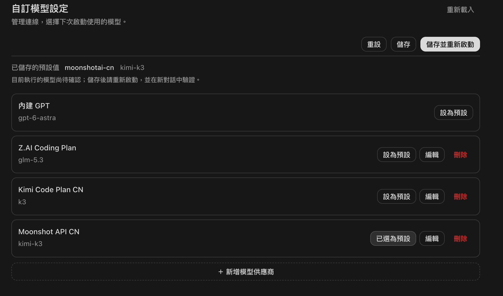
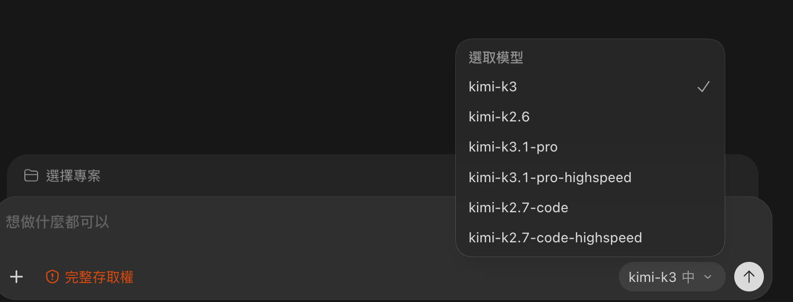

# 自定义模型配置 · Codex 本地插件

管理 provider、API Key 和默认模型；支持模型列表查询、重置、可选连接测试、Raw Data、保存和保存并重启。适用于 macOS 本地桌面端；不代理推理请求，不改变订阅权益。

## 界面预览

在插件中管理提供商、编辑接入配置并选择默认模型：



配置生效后，在 Codex 的模型菜单中选择服务商提供的模型。下图为 Kimi 示例，实际列表以所配置的服务商为准：



## 使用

安装后打开插件“自定义模型配置”，或使用全局导航入口。页面先显示加载状态，再准备 Python 环境和读取配置；失败时可在页面内点击“重试”。需要 Node.js 22+ 和 uv，详见下方安装说明。

1. 展开提供商，可直接编辑“配置名称”、接入地址、默认模型。已有 Key 只显示“已配置”，不会回填；输入框留空始终保留原密钥。
2. “刷新模型”从服务商查询模型列表。失败时已有列表保留，可手动输入准确模型 ID。列表出现不代表模型调用权限已验证。
3. “设为默认”选择下次启动的 provider。保存前可以重置（保留编辑并恢复最近保存值）。此操作均不写入磁盘。
4. 重置、保存与保存并重启位于顶部操作栏，滚动时保持可见。“保存”写入配置；“保存并重启”要求明确确认各窗口任务已结束，随后正常退出并重新打开客户端，不强制结束进程。若退出被系统拒绝，手动重启即可。
5. 重启后新建聊天验证。插件无法可靠读取桌面运行中的模型/provider，旧聊天可能保留原值；不会把文件内容当成当前运行结果。

内置 GPT 为固定选项，恢复首次外部切换前的原生设置；原生设置激活期间的外部人工修改也会被保留。若首次使用插件时已经选中了外部服务且没有记录原生配置，自动恢复按钮不可用，需先在本机恢复原生设置再读取。

## Raw Data

表单以外的参数采用 JSON。示例：

```json
{
  "provider": {"wire_api": "responses"},
  "model": {"model_context_window": 262144},
  "discovery": {},
  "health": null
}
```

`provider` 支持 `wire_api`、`request_max_retries`、`stream_max_retries`、`stream_idle_timeout_ms`、`http_headers`、`model_catalog_url`、`supports_websockets`。认证命令和密钥不允许在 Raw 中编辑；导入配置的隐藏请求头被保留，新增普通头采用合并方式。

`model` 支持 `model_context_window`、`model_auto_compact_token_limit`、`model_reasoning_effort`、`model_reasoning_summary`、`model_verbosity`。字段合法不代表服务商支持；须按服务实际能力填写。Kimi Code Moderato 的 `k3` 使用 262144 上下文，不应套用更高档位参数。

`discovery.url` 可指定同源完整模型列表 URL；默认使用 Base URL 下的 `/models`。`provider.model_catalog_url` 要求服务返回 Codex 完整目录格式，不是普通 OpenAI `data[].id` 列表。没有远程 Codex 目录时，插件将查询到的模型 ID 写入独立目录文件；只生成最小元数据，未知能力不推断。已有用户维护的本地目录会保留。

### 可选连接测试

“测试连接”仅在配置 `health` 后可用。可在高级配置中用“填入连接测试示例”生成以下草稿：

```json
{
  "path": "responses",
  "method": "POST",
  "body": {"model": "$model", "input": "Reply with OK.", "max_output_tokens": 64},
  "expectStatus": 200,
  "timeoutSeconds": 20
}
```

示例写入 Raw Data 的 `health` 字段；部分推理模型需要更大的输出限制，可自行修改。`$model` 替换为当前所选模型。GET 健康端点通常仅证明服务可达；POST 可能消耗少量额度。检查不会自动保存、切换或重启。改变地址、Key、模型或 Raw 后，旧检查结果立即失效。

请求仅允许同源 HTTPS 或 loopback HTTP，不跟随重定向。带查询参数的 API 地址暂不支持。命令认证、OpenAI 登录认证以及 env_http_headers 的插件内测试暂不支持，原有配置保留。

## 数据与回滚

- Codex 文件：`~/.codex/config.toml`（或进程的 CODEX_HOME）。
- 插件状态、模型缓存、生成目录及备份：`~/.codex/model-switcher/`。
- 凭证按现有 Codex 方式保存在本机 TOML；不是 Keychain 加密存储。文件及备份为 0600，不打包上传。
- 写入前备份、修订号检查、进程锁、原子替换；中断事务会在下次读取时恢复。其他程序不遵守锁时，最后检查和写入之间仍存在极短并发窗口。
- 保存后需要历史回滚时，备份位于 `model-switcher/backups`。先退出 Codex，核对对应 `.toml` 与 `.json`，恢复配置与插件状态；不要直接覆盖期间新增的其他设置。
- 本插件不处理项目配置/profile/命令行覆盖，实际加载结果仍以客户端为准。

## 开发与验证

需要 Node.js 22+、pnpm 10.33.0 和 [uv](https://docs.astral.sh/uv/getting-started/installation/)（本项目验证版本 0.11.2）。Python 3.12.13 由 uv 管理，无需自行配置系统 Python。JavaScript 使用 `pnpm-lock.yaml`；Python 使用 `pyproject.toml`、`uv.lock`、`.python-version`。

```sh
uv sync --locked --managed-python --no-config
pnpm install --frozen-lockfile
pnpm build
pnpm test
node tests/mcp-smoke.mjs
uv run --locked --managed-python --no-config python -m tests.codex-catalog
node scripts/build.mjs --test-ui
pnpm exec playwright install chromium
pnpm exec playwright test
pnpm package
uv run --locked --managed-python --no-config python tests/plugin-loader.py
```

`pnpm build`、`pnpm test`、`pnpm package` 均通过 uv 进入项目 `.venv`。`--locked` 要求依赖声明和锁文件一致，不会自动升级依赖；`--no-config` 避免继承机器上的 uv 配置文件。旧的 `requirements.txt` 和复制到 `backend/vendor` 的依赖已停用。Python 环境细节与升级步骤见 [Python 环境管理](docs/python-runtime.md)。

浏览器测试默认使用 Playwright Chromium，只访问临时配置。所有测试均不使用真实 Key、不发起真实收费调用、不重启当前客户端。重启辅助程序使用受控命令替身验证流程；真实客户端退出/重新启动需用户执行按钮后验收。

## 本地安装

发行目录 `release/local-marketplace` 包含完整的本地 marketplace。发行包包含 JS bundle、Python 源码与环境锁文件；用户无需安装 pnpm。首次准备 Python 和依赖可能需要联网，之后复用本机运行环境。

```sh
pnpm setup:runtime
codex plugin marketplace add /absolute/path/to/release/local-marketplace
codex plugin add codex-model-switcher@local-model-tools
```

`pnpm setup:runtime` 用于源码开发者预先准备运行环境；直接使用发行包时，在插件根目录运行 `node dist/setup-runtime.cjs`。也可让首次打开页面自动准备，超过 45 秒会提示改用上述命令，准备完成后重新加载即可。不会自动安装 uv 或退回系统 Python。

插件未显示时正常退出并重新打开桌面端。在 `Plugins` 中找到“自定义模型配置”并启用。只安装本地，不发布至云端。

升级安装完成不代表当前聊天已切换到新 MCP 进程。旧聊天或已打开的插件页可能继续连接旧版服务；若仍显示旧界面或启动错误，等其他任务结束后正常退出并重新打开 Codex，再进入插件验证。

## 可移植性与发布准备

源码仓库名称为 `codex-model-switch-tool`；插件内部 ID 保持 `codex-model-switcher`，避免影响已有安装。

- 运行入口使用 PATH 中的 Node.js；Python 由 uv 按锁文件准备，随后直接使用该虚拟环境中的解释器。`MODEL_SWITCHER_PYTHON` 已停用；可通过 `MODEL_SWITCHER_UV` 指定 uv 可执行文件，通过 `MODEL_SWITCHER_RUNTIME_DIR` 指定运行环境根目录（绝对路径）。
- macOS：当前已验证。Linux：配置读写使用 Unix 文件锁，设计上可用，但尚未在 Linux 实机验收。Windows：目前不支持，后端 fcntl 文件锁与 POSIX 权限需要适配；不要直接用于真实配置。
- 自动重启仅支持 macOS，通过 bundle ID 查找客户端，不依赖安装目录；其他系统需手动重启。
- UI 测试默认使用 Playwright Chromium（先执行 pnpm exec playwright install chromium）。也可设置 PLAYWRIGHT_CHROMIUM_EXECUTABLE_PATH 使用本机 Chromium/Chrome。
- 实际插件加载测试使用 PATH 中的 codex，可通过 TEST_CODEX_BIN 指定。
- 生成 dist 与 release：先运行 `pnpm build`，再运行 `pnpm package`。
- 仓库不收录用户配置、密钥、历史调试材料或依赖目录。`docs/images` 仅收录已确认可公开的界面示例，其他本地截图继续忽略。
- 项目采用 [MIT License](LICENSE)。

## 界面语言

配置页自动跟随 Codex 的语言，支持 English、简体中文、繁體中文，无需在插件中切换。语言改变时保留未保存草稿与编辑状态；未支持的语言回退英语。侧边栏的插件名称属于安装元数据，仍为固定名称。实现与测试见 [国际化说明](docs/i18n-assessment.md)。

## 作者

[guoz5658](https://github.com/scofield5658) · guoz5658@outlook.com
